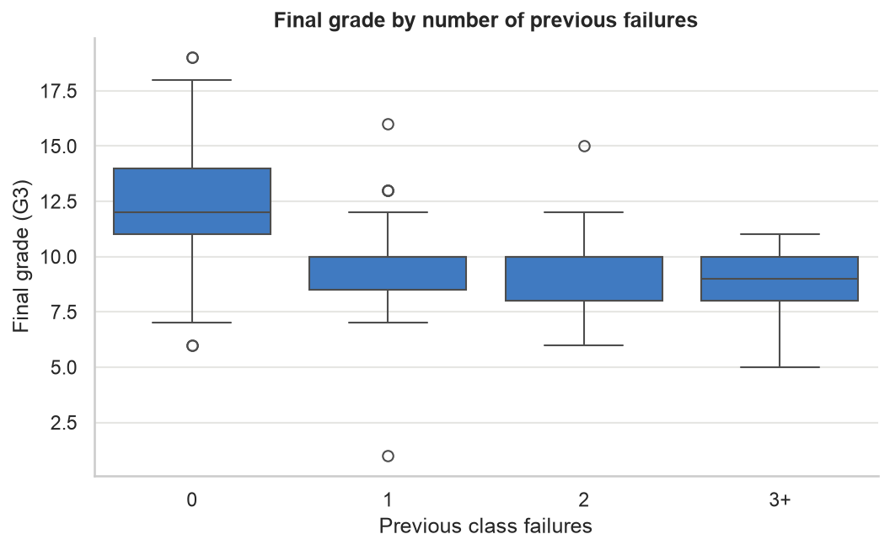
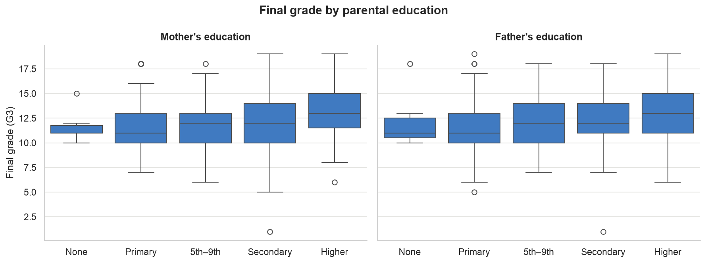

# Student Performance Analytics

## Project Overview

This project analyses student performance data to investigate factors associated with final academic performance.

The analysis uses student data containing information about study habits, absences, previous failures, parental education, school, and final grades.

## Research Questions

This project investigates five questions:

1. Is study time associated with final grade?
2. Are absences associated with final grade?
3. Are previous failures associated with final grade?
4. Is parental education associated with final grade?
5. Does final grade differ between the two schools?

## Outcome Measure

The primary outcome is **final grade, `G3` (0–20 scale)**.

## Dataset

The project uses the **UCI Student Performance dataset**, which contains student information from two Portuguese secondary schools.

The dataset contains separate files for:

- Mathematics (`student-mat.csv`)
- Portuguese (`student-por.csv`)

The **Portuguese dataset (`student-por.csv`)** will be used as the main dataset because it contains 649 students, providing a larger sample for the analysis.

The Mathematics dataset will also be preserved in `data/raw/` as part of the original dataset and may be considered for a future extension.

## Planned Analysis

The project will progressively cover:

- Data understanding and cleaning
- Exploratory data analysis
- Descriptive statistics
- Statistical hypothesis testing
- SQL analysis
- Machine learning

## Key Findings So Far (Exploratory Analysis)

| Factor | What the charts suggest |
|---|---|
| Previous failures | Strongest pattern: students with any past failure average below 10, vs 12.7 for those with none |
| Study time | More weekly study time goes with higher grades (levels off above 10 hours) |
| Parental education | Higher parental education, especially mother's, goes with higher grades |
| School | GP students average higher than MS students (12.6 vs 11.4) |
| Absences | Weak negative relationship (correlation ≈ -0.20) |

These are associations from charts only; they are tested statistically in the next stage.

All charts: [`reports/figures/`](reports/figures/) · Full analysis: [`notebooks/03_eda.ipynb`](notebooks/03_eda.ipynb)

## Dataset Source

Cortez, P. (2008). *Student Performance* [Dataset].
UCI Machine Learning Repository.

Dataset: https://archive.ics.uci.edu/dataset/320/student%2Bperformance

Licence: CC BY 4.0

## Project Status

- [x] Stage 1: Data understanding
- [x] Stage 2: Data cleaning (649 → 634 students)
- [x] Stage 3: Exploratory data analysis
- [ ] Stage 4: Statistical hypothesis testing
- [ ] Stage 5: SQL analysis
- [ ] Stage 6: Machine learning
